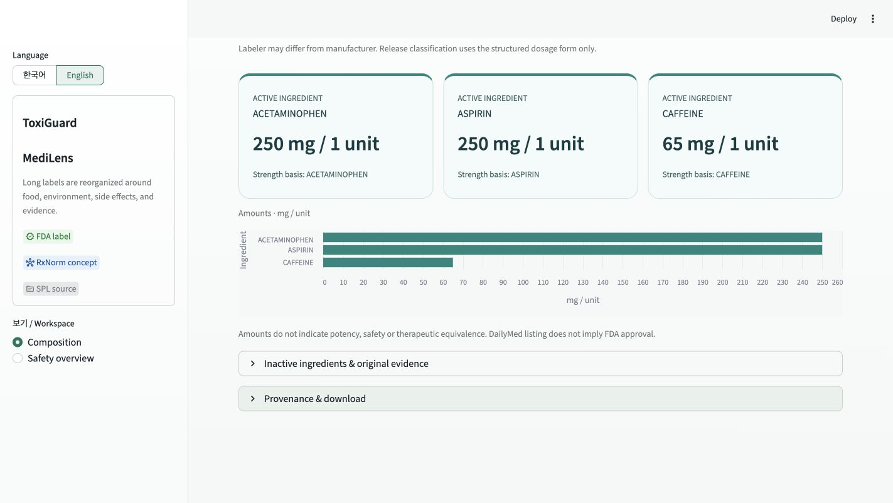
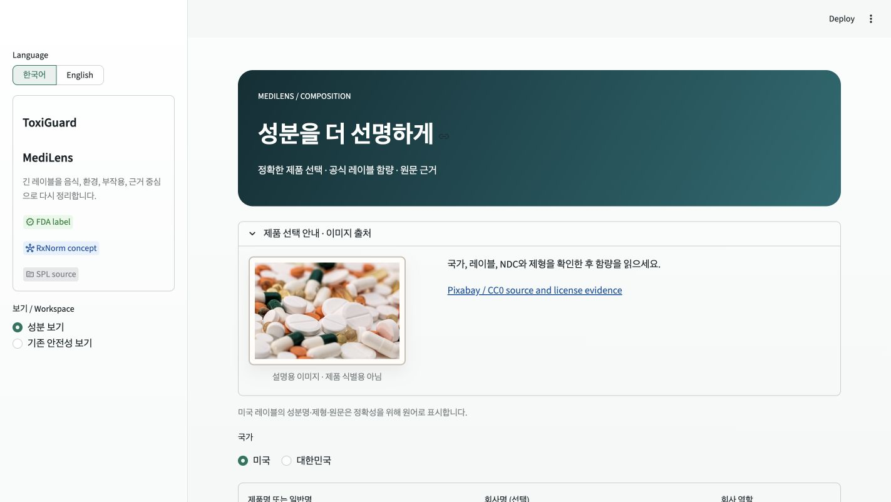

# MediLens composition preview

**Latest design:** [Ingredient-specific molecular visualization](MOLECULAR_REVISION.md), 44 tests.

**Updated interface:** [Quantitative visualization revision](VISUAL_REVISION.md) replaces the original number cards shown below. Current validation has 31 tests; this document retains the initial implementation record.

Repository: https://github.com/lyn0109-Toxi/ToxiGuard-MediLens

Base: `1e59a12071c78860cd5b59bfd556e27009729bdc` · Branch: `feature/composition-preview`

## Result

New composition workspace integrated into the existing Streamlit `app.py`. Original safety workspace and existing source folder are preserved. No push, public deployment, or Streamlit Cloud configuration changes were made.

Preview: http://127.0.0.1:8517 (local Mac only).

Restart from this repository with:

```bash
python3 -m streamlit run app.py --server.address 127.0.0.1 --server.port 8517 --browser.gatherUsageStats false
```

Search by brand/generic name and optional manufacturer or labeler. Select the exact DailyMed label, then structured product with strength, dosage form and NDC. Release differences remain in the form and are displayed explicitly. Absence of extended-release wording is never interpreted as proof of immediate release.

Large ingredient cards preserve the SPL numerator and denominator. UCUM `1` is displayed as `unit`, with original units retained in evidence JSON/XML. ACTIB uses ingredient-substance basis; ACTIM uses active-moiety basis; ACTIR uses the declared reference substance. Salt, moiety and reference are retained separately. Charts convert g/mg/ug/mcg and L/mL/uL only; unknown or incompatible units/bases are excluded. All charted values come from the selected SPL, not the supporting photo.

Inactive amounts absent from SPL are “not disclosed,” not zero. No IID estimates, full-composition pie, therapeutic equivalence claim, or FDA approval inference. Evidence contains SPL ID/version/effective date, retrieval timestamp, source links, original ingredient XML and original description/ingredient text sections. Exportable evidence JSON is available.

## Validation (2026-10-16)

- `python3 -m unittest discover -s tests -v`: **23 tests passed**.
- `python3 -m compileall -q composition.py composition_ui.py app.py`: passed.
- `git diff HEAD^ HEAD --check`: passed (official XML fixture whitespace preserved via `.gitattributes`).
- Real downloaded DailyMed labels cover acetaminophen tablet (500 mg/unit), Excedrin combination (250/250/65 mg per unit), acetaminophen liquid (160 mg/5 mL, normalized to 32 mg/mL), metoprolol succinate ER in four strengths (including tartrate strength basis), and unsupported nested kit.
- Synthetic unit tests cover explicit immediate/delayed release forms, g/mg/ug and L/mL conversions, incompatible units, nonfinite/zero/negative/missing values, unknown basis, ambiguous results, empty and missing names, no-match responses, unreadable sources, identity mismatch, and connection failures.
- Streamlit AppTest covers both languages, MFDS-unavailable state, mandatory label and product selection, amount cards, failed label fetch, stale-result clearing after failed search, and original app startup.
- Chrome visual checks: Korean hero with licensed supporting PNG; live English Excedrin search with 30 candidate labels; exact label/product selection; three amount cards and chart. Real no-match API query using `zzzznonexistentmedilensabc` returned an empty list.





Additional disambiguation screenshot: [English selection](english-combination.jpg).

## Remaining limitations

- MFDS API is not configured. No Korean product composition is returned. Add an authorized MFDS product adapter with matching identity/unit tests before enabling Korea.
- RxNorm is not used to fill or infer strength values in the new workspace. Existing safety functionality retains its prior RxNorm links. The exact SPL is authoritative for this preview.
- Structured manufacturer may be absent even where the author/labeler is present. The UI reports the scoped absence and never substitutes the labeler as manufacturer. Source free text remains available for review.
- Release type is shown as unspecified if the structured dosage form does not explicitly identify it. No clinical equivalence is inferred across variants.
- Nested kit parts are intentionally unsupported in this first version. Labels without supported structured composition link to the source instead of fabricating a result.
- DailyMed search is paginated, 30 labels per page. The UI provides the page control and total count. Results depend on DailyMed availability and current submissions; this is not a marketing-status verification service.
- Source ingredient and form wording remains English under Korean navigation. No medical translation is invented.
- New supporting PNG is a resized export of a Google-discovered CC0 photograph. Commons records the original-source license review; direct original Pexels retrieval failed in the research tool. Full source/license evidence is in `assets/COMPOSITION_IMAGE_LICENSE.md`. Existing image assets were preserved and were not re-audited.
- Local desktop visual QA used the connected Chrome viewport; no device matrix or external accessibility audit was performed.

## Review / deployment requirements

Review the branch and public-label behavior. A later approved deployment would need the reviewed changes merged/pushed to the branch used by Streamlit Cloud and a restart/redeploy. Existing `requirements.txt` already contains the needed Streamlit and certifi dependencies; no new runtime package is required. Allow outbound HTTPS to `dailymed.nlm.nih.gov`; no US API key is needed. Public deployment remains pending user review and explicit approval.

## Changed files

- `app.py`: workspace switch and composition integration.
- `composition.py`: official API access, SPL parsing, quantity preservation and compatible-unit conversion.
- `composition_ui.py`: bilingual selection, cards, chart, provenance, missing/source-failure states.
- `assets/composition-pills.png`, `assets/COMPOSITION_IMAGE_LICENSE.md`: new supporting image and evidence.
- `tests/test_composition.py`, `tests/test_composition_ui.py`, `tests/fixtures/`: automated validation with public source fixtures.
- `.gitattributes`: preserve official SPL fixture whitespace.
- `README.md`, `review/`: operating and review instructions with screenshots.
